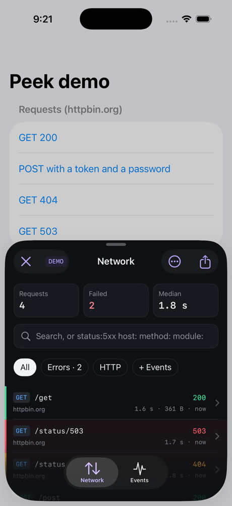
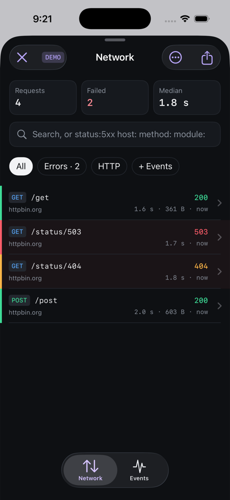
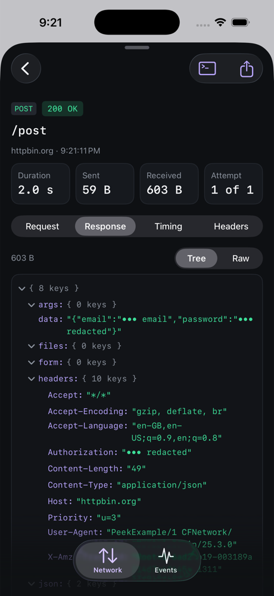
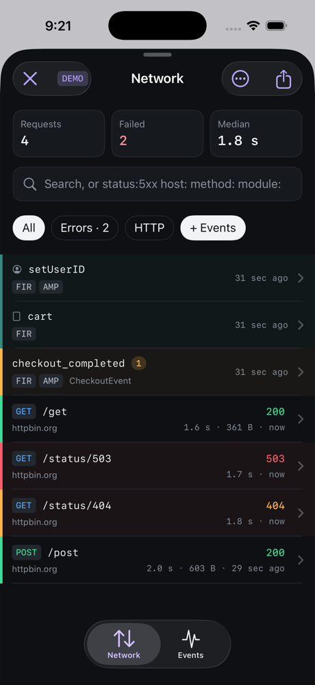
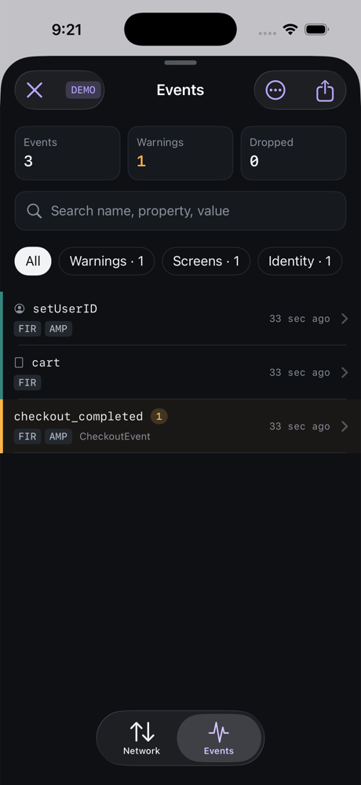
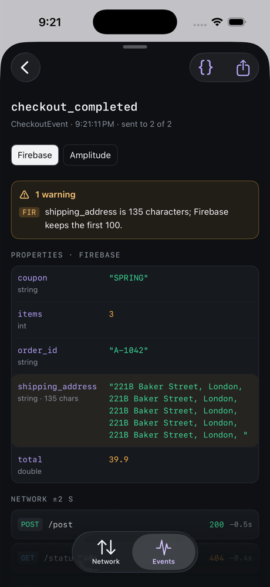

# Peek

**See everything your iOS app sends — without a proxy, a cable or a debugger.**

Peek is an in-app inspector: a floating button that opens a panel with every network request, socket message and
analytics event your app produced, as it happens. Built for QA and developers testing on real devices.

<p align="center">
  
  
  
</p>
<p align="center">
  
  
  
</p>

## Features

| | |
|---|---|
| **Network** | Every request with headers, body (JSON tree, images, text), status, size and a timing waterfall (DNS, TLS, waiting…). Retries grouped. Search like `status:5xx host:api method:post`. |
| **Sockets** | Messages and connection changes, in the same timeline as requests. |
| **Analytics events** | Each event per destination (Firebase, Amplitude, …) with its properties and types. Warnings for SDK limits (Firebase names and 100-char values, CleverTap limits, Adjust tokens), wrong types and personal data. Identity calls, logs and errors too. |
| **One timeline** | “+ Events” mixes events into the request list, so you see which call triggered which event. |
| **Redaction** | Tokens, passwords, cookies, emails and phone numbers are masked by default, even inside nested JSON. One switch reveals the real values (kept in memory only) when you need a working cURL. |
| **Share** | Copy as cURL, export HAR (Charles, Proxyman, Chrome), Markdown reports for Jira or Slack, JSON. |
| **Zero-setup capture** | `URLSession` traffic — `async`/`await` (`data(for:)`, `upload(for:)`) and completion handlers — plus Firebase `logEvent` and Sentry, including calls made inside third-party packages. |
| **Light** | No dependencies. Capture costs about a microsecond on the calling thread; everything else runs in the background. |

Requires iOS 16.6+.

## Install

Swift Package Manager:

```swift
.package(url: "https://github.com/mohammadhamdan1991/Peek.git", from: "0.1.0")
```

Add the `Peek` product to your app target.

## Quick start

```swift
import Peek

@main
struct MyApp: App {
    init() {
        #if DEBUG
        Inspector.start(InspectorConfiguration(capturesAllURLSessionTraffic: true))
        #endif
    }
    var body: some Scene { WindowGroup { ContentView() } }
}
```

A floating button appears on every window. Tap it to open the panel; long-press for quick actions (copy last cURL,
pause, clear, hide).

## Keep it out of production

Peek is a debugging tool: don't ship it to your users. Pick one:

1. **Simple:** call `Inspector.start` only inside `#if DEBUG` (or your own flag). Peek is linked but never starts,
   and `Inspector.start` also refuses to run when `isProductionEnvironment` is true, for an unlisted bundle id
   (`allowedBundleIdentifiers`) or for an App Store install.
2. **Strict:** add `PEEK_DISABLED` to *Active Compilation Conditions* for your release configurations. Every Peek
   source file compiles to nothing, so the binary contains none of it. This needs the flag to reach the package
   targets (Tuist `PackageSettings`, or compiling the sources as your own targets). Then run
   [`Scripts/verify_no_peek.sh`](Scripts/verify_no_peek.sh) on every release `.ipa` in CI: it fails the build if any
   Peek code is inside.

## Feeding it data

| What | How |
|---|---|
| `URLSession` traffic | `capturesAllURLSessionTraffic: true`: `async` `data(for:)` / `data(from:)` / `upload(for:)` and completion-handler `dataTask` / `uploadTask`. Not covered: delegate-only tasks and `bytes(for:)` streams. |
| Your own networking layer | call `Inspector.capture.started(...)`, `.finished(...)`, `.timing(...)` from its logger: retries, decoding errors and modules show up |
| Sockets | `Inspector.socketCapture.record(...)` from your socket client's event handler |
| Analytics | `Inspector.eventCapture.track(source:deliveries:...)` from your analytics layer, one delivery per destination |
| Identity, logs, errors | `Inspector.eventCapture.record(.identity / .log / .error, name, to: [...])` |
| Firebase / Sentry calls you don't own | `DirectSDKCapture.install(Inspector.eventCapture)`; wrap your own analytics forwarding in `DirectSDKCapture.whileForwarding { … }` |

## Example

```bash
cd Example && tuist install && tuist generate
```

## License

MIT
